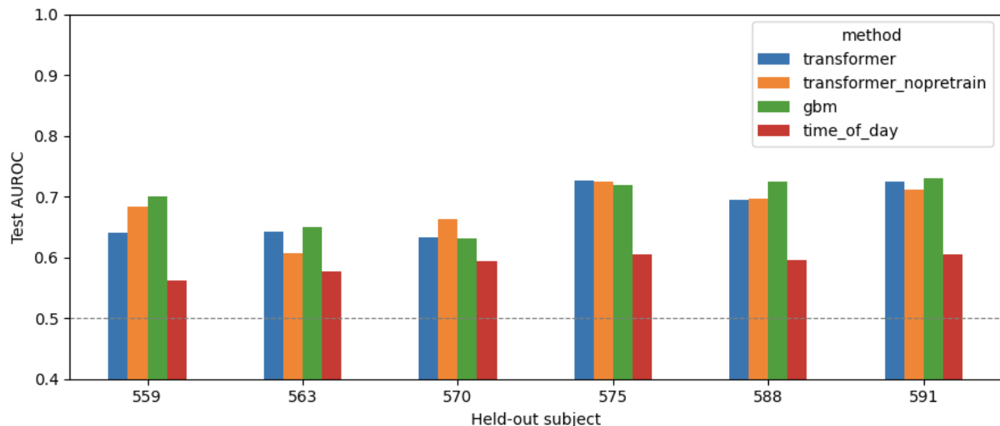

# bolus-transformer

This project tries to predict when a person with type 1 diabetes is about to take a meal bolus, using CGM and wearable data from the [OhioT1DM](https://pmc.ncbi.nlm.nih.gov/articles/PMC7881904/) dataset.

The main model is a small causal transformer. It's first pretrained to forecast the sensor signals 30 minutes ahead, then fine-tuned to predict bolus timing. I compare it against the same transformer without pretraining, gradient-boosted trees on hand-built features, and a logistic regression that only knows the time of day.

The prediction target, at every 5-minute CGM reading t, is whether a bolus gets logged in (t, t + 20 min]. These labels come from what patients actually logged, so they reflect behavior rather than when a bolus would have been medically ideal.

## Results

Leave-one-subject-out over the 6 subjects, 3 seeds each (18 runs per method), mean ± std. About 6.7% of timesteps are positive.

| Method | AUROC | AP | Bolus recall | False alarms/day | Median lead (min) |
|---|---|---|---|---|---|
| Transformer (pretrained) | 0.677 ± 0.042 | 0.118 ± 0.037 | 0.140 ± 0.112 | 6.2 ± 5.5 | 10 ± 2 |
| Transformer (no pretraining) | 0.681 ± 0.040 | 0.118 ± 0.030 | 0.139 ± 0.092 | 5.8 ± 3.8 | 10 ± 2 |
| Gradient-boosted trees | 0.692 ± 0.038 | 0.133 ± 0.036 | 0.165 ± 0.104 | 4.8 ± 3.2 | 10 ± 2 |
| Time of day only | 0.590 ± 0.015 | 0.085 ± 0.023 | 0.021 ± 0.015 | 1.0 ± 0.1 | 13 ± 3 |

Recall and false alarms use a threshold picked on the validation subject to allow at most 4 false alarms per day (see Evaluation).



What I take from this:

- **Physiology helps beyond meal times.** Every model beats the time-of-day baseline on every subject, by roughly 0.1 AUROC. Glucose trends and insulin on board carry real information about upcoming boluses.
- **The transformer doesn't beat gradient-boosted trees.** Subject by subject, the trees win clearly on 559 and 588 and tie on the rest. With 6 subjects and meals unobserved, a few good tabular features capture most of the available signal.
- **Pretraining doesn't help classification.** The pretrained encoder forecasts 30 minutes ahead 12% better than persistence (weighted MSE 0.335 vs 0.382), but fine-tuning from it scores the same as training from scratch.
- **Alarm thresholds don't transfer well between people.** A threshold tuned for 4 false alarms/day on one subject gave anywhere from 1 to 18 on another. Calibrating on a new patient's first few days of data looks like the most useful next step.

## How it works

### Data

The 2018 OhioT1DM cohort (subjects 559, 563, 570, 575, 588, 591, recorded with the Basis band). Each timestep has 9 inputs:

- glucose
- heart rate, GSR, skin temperature, air temperature
- insulin on board, computed from the dose log with a fixed decay curve (peak at 75 min, gone by 300 min)
- carbs entered with each bolus
- time of day, encoded as sin and cos so 23:55 and 00:00 end up close together

Wearable readings are matched to CGM timestamps with a backward as-of merge (2.5 min tolerance), so a row never takes a reading from the future. Each recording is trimmed to the span where all wearables have data. GSR and carbs are log-transformed, then everything is z-scored using statistics from the training subjects only.

### No look-ahead

Features at time t only use boluses logged at or before t, and the label at t only asks about boluses after t. So a row never contains the bolus it's being asked to predict. Because boluses usually fall between CGM readings, this is easy to get wrong. `tests/test_pipeline.py` checks it directly: deleting every bolus after t must not change any feature at t.

### Model

- Each signal gets its own linear embedding. The embeddings are concatenated and projected to one 32-dim token per timestep, plus a learned position embedding.
- 3 transformer encoder blocks (4 heads) with a causal mask, so each position only attends to the past. The context is 36 tokens, which is 3 hours.
- **Pretraining:** a linear head predicts each sensor 30 minutes ahead. The loss is masked MSE, so missing readings aren't penalized, and glucose is weighted 4x.
- **Fine-tuning:** a small MLP head outputs a bolus logit at every position. It's trained with BCE, with positives weighted by the negative/positive ratio (about 14x).
- The first 12 positions of each window are left out of losses and metrics, since the model has seen less than an hour of context there.

### Baselines

- **Gradient-boosted trees** (`HistGradientBoostingClassifier`) on glucose and its 15/30/60-minute changes, insulin on board, carbs in the last 3 hours, minutes since the last bolus, heart rate, and time of day.
- **Logistic regression** on time of day only. This checks how much a model is just learning when people usually eat.

### Evaluation

- **Leave-one-subject-out.** Each fold uses one test subject, the next subject in the list for validation, and the remaining four for training. Every subject is the test subject once.
- **Validation subject.** It picks the best checkpoint (lowest forecast error for pretraining, highest AP for fine-tuning, with early stopping) and the alarm threshold. The test subject is never used for either.
- **Test data.** Both of the test subject's recordings (the dataset's training and testing splits) are scored. A sliding window covers every timestep exactly once.
- **AUROC and AP.** AP is the more informative of the two here because positives are rare. A random model's AP equals the base rate, 0.067.
- **Alarms.**
  - An alarm fires when the predicted probability crosses the threshold going up.
  - It counts as a false alarm if no bolus follows within 20 minutes.
  - A bolus counts as caught if an alarm fired in the 20 minutes before it.
  - Lead time is measured from that alarm to the bolus.

## Running it

**Colab:** open `insulin_model_bolus.ipynb`, upload the OhioT1DM XML files to `bolus_data/`, and run all cells. A full run trains 36 transformers (6 folds × 3 seeds × with and without pretraining), so a GPU runtime helps. Set `QUICK = True` to check that everything runs before committing to the full run.

**Locally:**

```bash
cd bolus_transformer_py
pip install -r requirements.txt
python main.py --data-dir /path/to/OhioT1DM
python -m pytest tests
```

The tests generate synthetic data in the OhioT1DM format, so they run without the real dataset. Access to OhioT1DM requires a data use agreement with its authors.

## Layout

```
insulin_model_bolus.ipynb       full pipeline as a notebook
bolus_transformer_py/
  main.py                       CLI, writes results/results.csv and results/summary.md
  bolus_transformer/            same code as the notebook, split into modules
  tests/                        look-ahead, labels, normalization, metrics, end-to-end
figures/
```

## Limitations

- **Small cohort.** Only 6 subjects, and results vary a lot between them.
- **Even spacing assumed.** Timesteps are treated as exactly 5 minutes apart, so gaps in CGM data compress time inside a window.
- **One insulin curve for everyone.** The insulin-on-board curve is the same for every patient and ignores basal insulin.
- **Shorter history than the trees.** The transformer sees 3 hours of history, while the tree baseline's minutes-since-last-bolus feature can reach back further.

Not for clinical use.

## License

MIT
